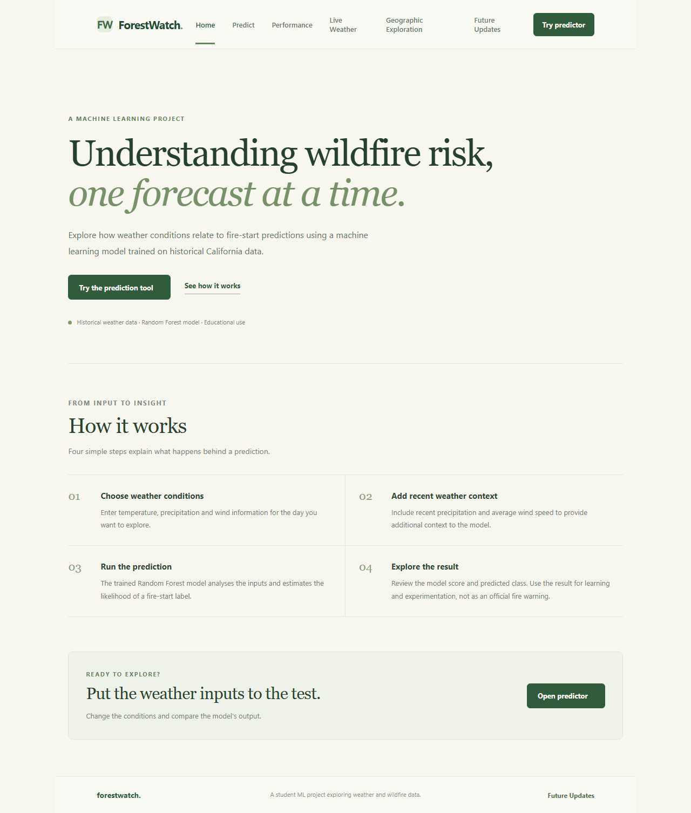
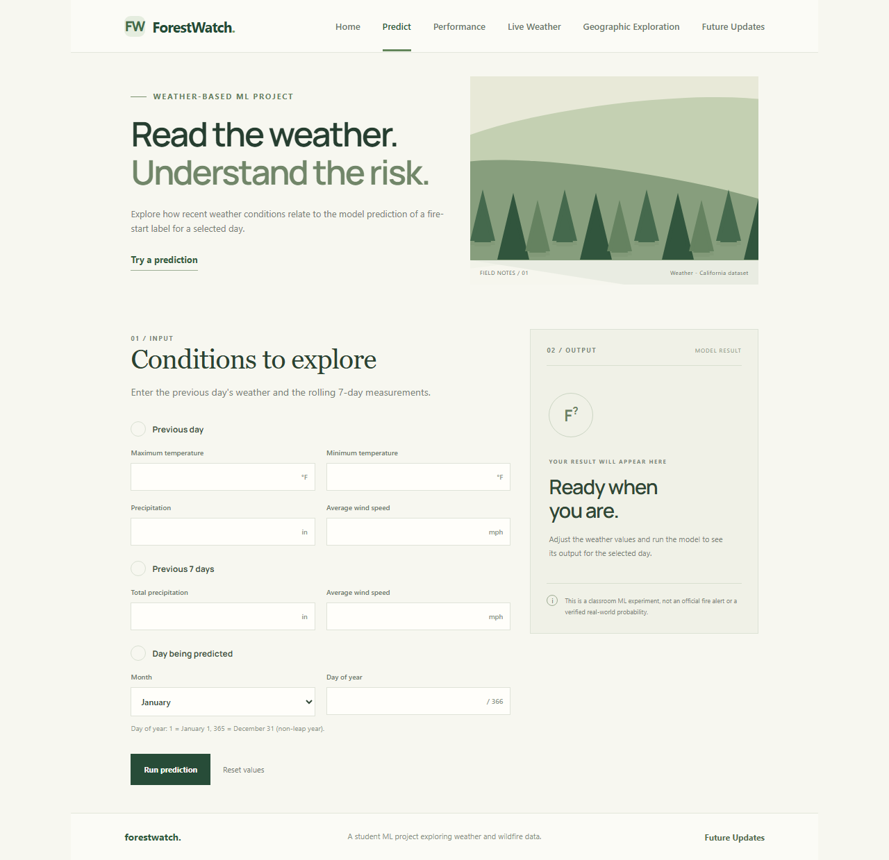
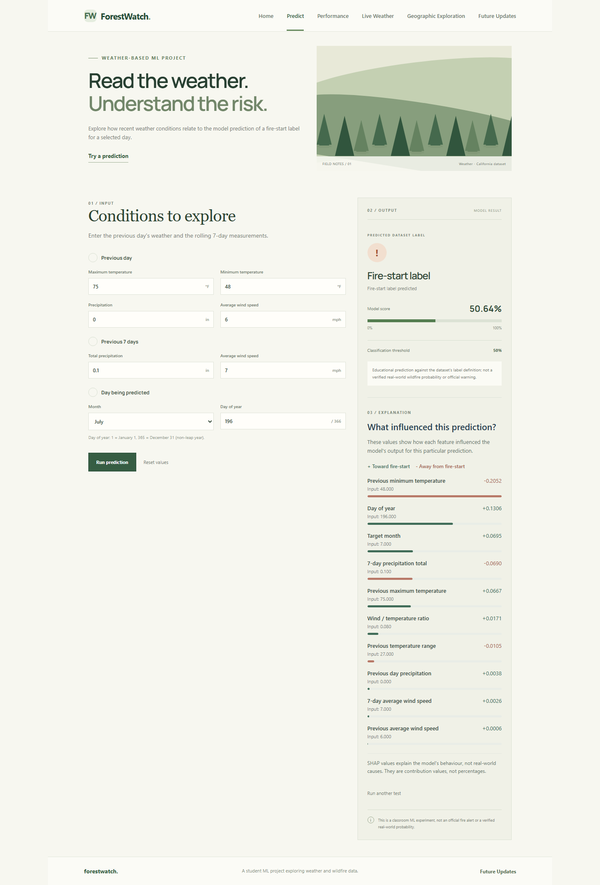
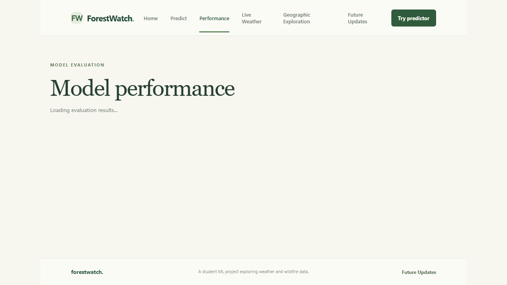
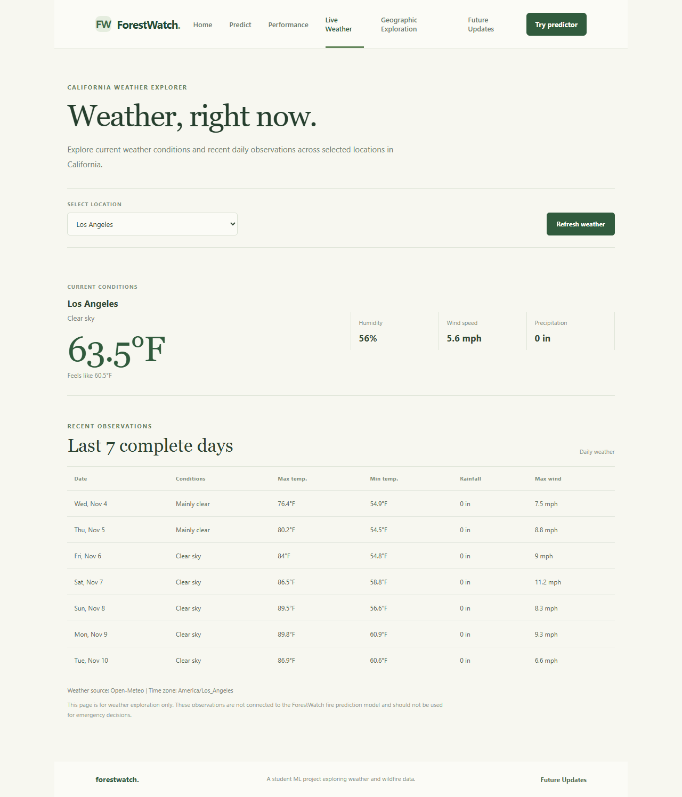
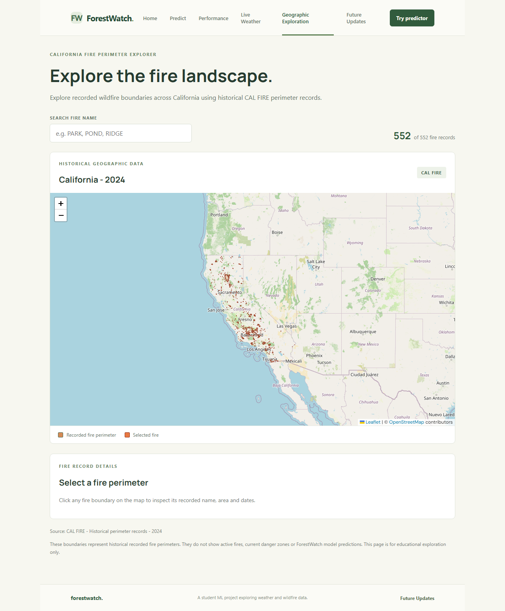
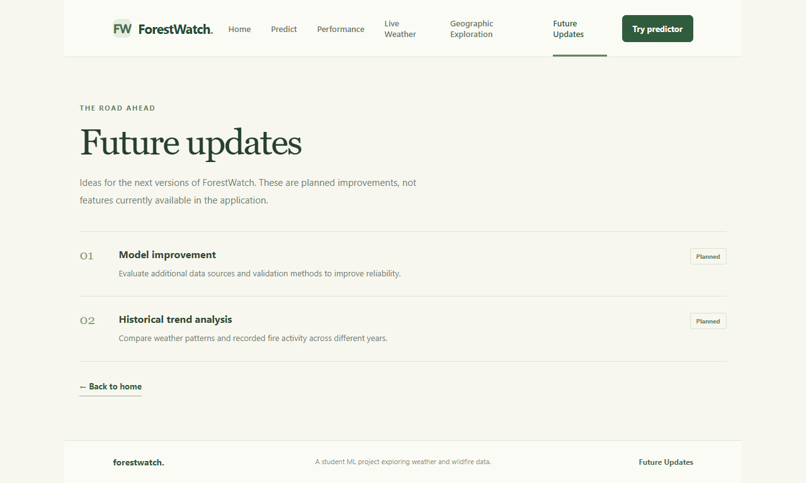

# ForestWatch 🌲

ForestWatch is a student machine learning project focused on exploring forest fire data and estimating next-day fire occurrence using weather-related features.

The project combines a machine learning model, model evaluation, weather information, and historical fire perimeter visualization in one web application.

**Note:** ForestWatch is an academic project. Its predictions are experimental and should not be used for real-world emergency decisions or wildfire response.

## Features

- **Fire Prediction:** Estimate next-day fire occurrence using weather and date-related inputs.
- **Model Explanation:** View feature contributions using SHAP.
- **Model Performance:** Check evaluation metrics and the confusion matrix.
- **Model Comparison:** Compare Random Forest and Logistic Regression.
- **Live Weather:** View current and recent weather information for selected California cities.
- **Geographic Exploration:** Explore historical 2024 CAL FIRE perimeter records on an interactive map.
- **Future Updates:** View possible improvements planned for the project.

## Tech Stack

**Frontend**
- React 19
- Vite
- React Router
- Leaflet
- React Leaflet
- CSS

**Backend**
- Python 3.13
- FastAPI
- Uvicorn
- Pandas
- NumPy
- Scikit-learn
- SHAP

**Data and Visualization**
- Matplotlib
- Open-Meteo API
- CAL FIRE perimeter data
- GeoJSON

## Project Structure

```text
ForestWatch/
│
├── backend/
│   └── api/
│       ├── main.py
│       ├── evaluation.py
│       ├── comparison.py
│       ├── weather.py
│       └── geography.py
│
├── frontend/
│   ├── src/
│   │   ├── App.jsx
│   │   ├── Weather.jsx
│   │   ├── Geography.jsx
│   │   └── ...
│   ├── package.json
│   └── index.html
│
├── data/
│   ├── CA_Weather_Fire_Dataset_1984-2025.csv
│   ├── next_day_fire_dataset.csv
│   ├── calfire_2024_perimeters_simplified.geojson
│   └── calfire_perimeters.csv
│
├── models/
│   └── forest_fire_model.pkl
│
├── train_model.py
├── save_model.py
├── predict.py
├── requirements.txt
└── README.md
```

The repository also contains supporting data-validation files and analysis scripts.

## Requirements

- Python 3.13
- Node.js and npm
- Git (optional)

## Installation and Setup

### 1. Clone the repository

```bash
git clone https://github.com/AnujUpadhayay07/ForestWatch.git
cd ForestWatch
```

### 2. Set up the backend

Create and activate a virtual environment:

```powershell
python -m venv .venv
.\.venv\Scripts\Activate.ps1
```

Install Python dependencies:

```powershell
pip install -r requirements.txt
```

Start the backend:

```powershell
python -m uvicorn backend.api.main:app --reload --host 127.0.0.1 --port 8000
```

Backend API:

```text
http://127.0.0.1:8000
```

API documentation:

```text
http://127.0.0.1:8000/docs
```

### 3. Set up the frontend

Open another terminal:

```powershell
cd frontend
npm install
npm run dev
```

Open the local development URL shown by Vite, usually:

```text
http://localhost:5173
```

Keep the backend and frontend terminals running while using the application.

## Application Pages

| Page | Route | Description |
|---|---|---|
| Home | `/` | Project introduction and overview |
| Predict | `/predict` | Enter weather features and estimate fire occurrence |
| Performance | `/performance` | View evaluation metrics and compare models |
| Live Weather | `/weather` | Explore current and recent weather conditions |
| Geographic Exploration | `/geography` | Explore historical 2024 CAL FIRE perimeters |
| Future Updates | `/future-updates` | View planned improvements |

## Screenshots

The following screenshots show the main pages and an example prediction from the deployed application.

<p align="center">
  
  
</p>

<p align="center">
  
</p>

<p align="center">
  
  
</p>

<p align="center">
  
  
</p>

---

## Backend API Endpoints
| Method | Endpoint | Purpose |
|---|---|---|
| GET | `/` | Backend welcome response |
| GET | `/api/health` | Check backend status |
| POST | `/api/predict` | Generate a fire prediction |
| GET | `/api/evaluation` | Retrieve model evaluation results |
| GET | `/api/model-comparison` | Compare model performance |
| GET | `/api/weather?location=Los%20Angeles` | Retrieve weather information |
| GET | `/api/fire-perimeters` | Retrieve historical fire perimeter data |

## Prediction Inputs

The prediction endpoint accepts the following features:

| Feature | Description | Unit |
|---|---|---|
| `previous_day_precipitation` | Previous day's precipitation | Inches |
| `previous_day_max_temp` | Previous day's maximum temperature | °F |
| `previous_day_min_temp` | Previous day's minimum temperature | °F |
| `previous_day_avg_wind_speed` | Previous day's average wind speed | mph |
| `previous_7d_precipitation_sum` | Total precipitation over the previous 7 days | Inches |
| `previous_7d_wind_speed_mean` | Average wind speed over the previous 7 days | mph |
| `target_month` | Month of the prediction date | 1–12 |
| `target_day_of_year` | Day number of the prediction date | 1–366 |

The backend validates the input values before generating a prediction.

## Model Evaluation and Comparison

The project uses a saved Random Forest model for fire prediction.

The Performance page displays evaluation metrics such as:

- Accuracy
- Balanced Accuracy
- Precision
- Recall
- F1-score
- ROC-AUC
- PR-AUC
- Confusion Matrix

The project also compares Random Forest with Logistic Regression using the same feature set and chronological data split.

The model training cutoff is **January 1, 2020**. Evaluation uses data from the later period as a historical held-out test set.

These results describe performance on the available dataset. They do not guarantee accuracy for future or real-world wildfire events.

## Live Weather

The Live Weather page uses the Open-Meteo API to retrieve weather information for five California locations:

- Los Angeles
- San Francisco
- Sacramento
- San Diego
- Redding

It displays current weather conditions and recent historical weather observations.

Weather information is provided for exploration only. It is not directly connected to the fire prediction model.

## Geographic Exploration

The Geographic Exploration page displays historical fire perimeter records from CAL FIRE for 2024.

It includes:

- Interactive fire perimeter map
- Fire name search
- Fire perimeter selection
- Fire acreage
- Alarm date
- Containment date

The map uses a simplified GeoJSON dataset containing 552 historical records.

**Important:** These are historical fire perimeters, not live fire locations or active incident updates.

## Machine Learning Workflow

The project follows a chronological data split to maintain the time order of observations.

1. Load and inspect the weather and fire dataset.
2. Prepare the features required for next-day fire prediction.
3. Split the dataset using the January 1, 2020 training cutoff.
4. Train the Random Forest model on the earlier records.
5. Evaluate the model using later records.
6. Save the trained model for backend prediction.
7. Use the saved model to generate predictions through the API.
8. Apply SHAP to help explain feature contributions.

## Dataset

The project uses a California weather and fire dataset covering records from 1984 to 2025.

The dataset contains weather-related features and fire occurrence information. Additional CAL FIRE perimeter data is used for historical geographic exploration.

Data preparation, validation, and supporting analysis files are also included in the project.

## Limitations

- Predictions depend on the quality and availability of input data.
- Historical model performance may not represent future wildfire conditions.
- Weather information depends on the external Open-Meteo service.
- Geographic exploration currently displays historical 2024 CAL FIRE records only.
- The project does not provide real-time wildfire detection or emergency alerts.

## Future Improvements

Possible improvements include:

- Adding more recent and diverse fire datasets.
- Improving model performance and validation.
- Adding historical fire trend analysis.
- Expanding geographic coverage.
- Exploring additional weather and environmental features.

## Academic Purpose

ForestWatch was developed as an academic machine learning project to explore data preprocessing, model training, model evaluation, explainability, API development, and frontend integration in a single application.
